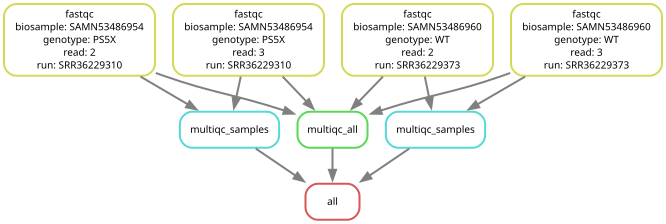
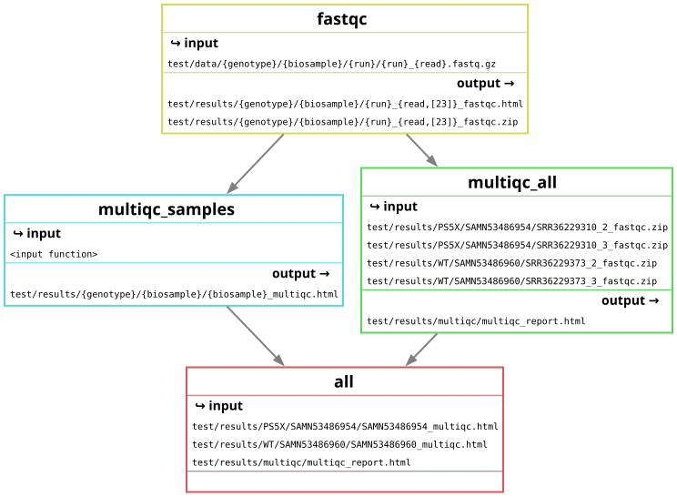
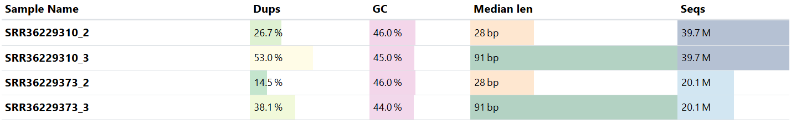
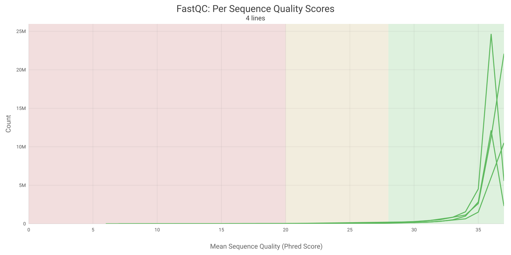
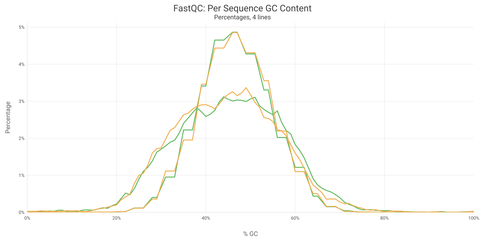

# fastq-qc

Snakemake pipeline that takes fastq.gz files and produces fastqc reports for each SRA run. Multiqc is then used to aggregate the fastqc reports into a singular quality control report. This report can be in the results directory after executing. 

Required dependencies to run:

    1. conda
    2. snakemake

Test:

`snakemake --cores 4 --use-conda --configfile "test/config.yaml"`

Run with user provided meta.csv:

`snakemake --cores 4 --use-conda --config META="your/path/meta.csv"`

# **Workflow**

## **Figure 1. Test directed acyclic graph (DAG)**

## **Figure 2. Test file graph DAG**

# **Plots from multiqc report**

## **Figure 3. Aggregated general statistics**

## **Figure 4. Aggregated per sequence quality scores**

## **Figure 5. Aggregated per sequence gc content**

